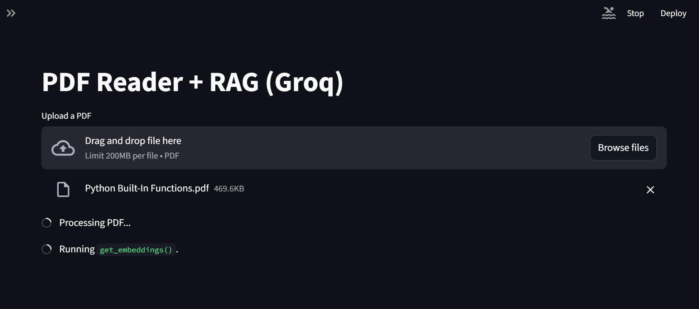
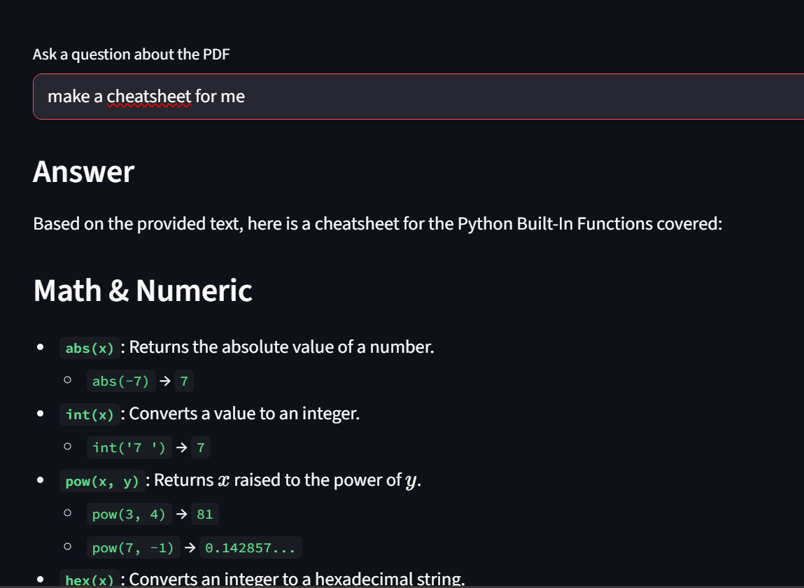

# PDF Reader with RAG using Groq

A Streamlit app that lets you upload a PDF and ask questions using Retrieval Augmented Generation (RAG) powered by Groq LLMs.

## Demo

## Features
- Upload and process PDF files
- Chunk and embed documents with HuggingFace embeddings
- Store vectors in FAISS
- Query with Groq models (qwen/qwen3.8-27b)
- View source chunks for answers

## Setup
1. Clone the repo
`ash
git clone https://github.com/mahak-025/PDF_reader.git
cd PDF_reader
`

2. Install dependencies
`ash
pip install -r requirements.txt
`

3. Add your Groq API key in pp.py or set env var
`ash
set GROQ_API_KEY=your_key
`

4. Run the app
`ash
streamlit run app.py
`

## Tech Stack
- Streamlit
- LangChain
- Groq
- FAISS
- HuggingFace Sentence Transformers
- PyPDF
